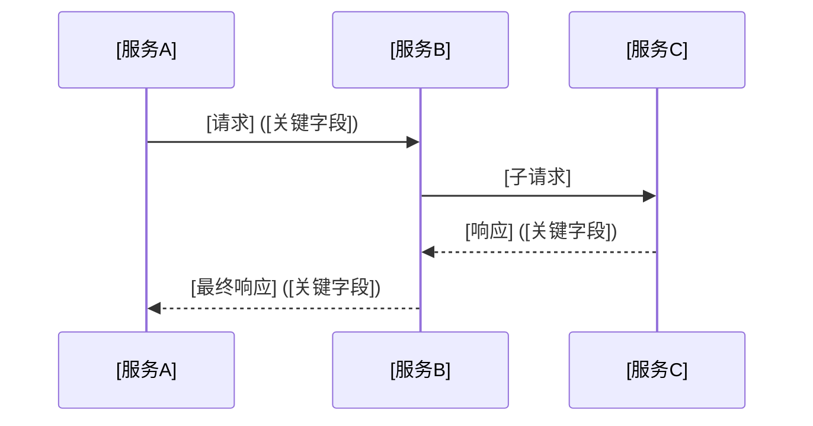
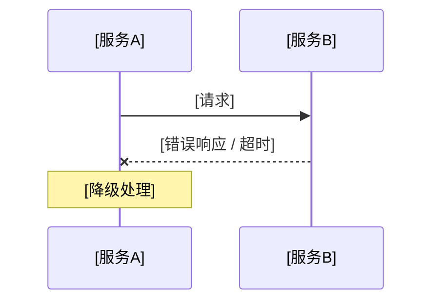

# 技术规格模板

在生成技术规格时使用此结构。标注"可选"的节在无内容时直接省略——不留"不适用"。

---

```markdown
# [Feature Name] — 技术规格

> 来源：用户需求文档 `docs/specs/spec-<NAME>.md`
> 参考架构：`repos/arch-index.md`（L0）[、`docs/arch/{repo}/docs/arch-index.md`（L1，按实际列出）]
> 日期：YYYY-MM-DD
> 版本范围：[vX.X（哪些 SR 属于本版本，哪些延后）]

---

## 关键决策记录 <!-- 极少省略：绝大多数 PRD 有需要记录的决策 -->

> 来源：`spec-<NAME>.md` Clarifications 节及架构约束审查。记录影响接口设计、服务边界和存储策略的核心决策，保留"为什么"以防止后续误改。

| ID | 决策内容 | 理由 | 影响范围 |
|----|---------|------|---------|
| D-1 | [决策的明确表述，what is decided] | [来自 PRD Clarification 的理由，或架构约束推导] | [受影响的 SR 编号] |

<!-- 填充规则：
- PRD Clarifications 节中每条影响接口设计、字段命名、编码格式、行为分支的 Q/A → 一条 D-N 记录
- PRD Assumptions 节中有架构含义的假设（单向迁移、第三方库绑定、兼容性承诺）→ 一条 D-N 记录
- "影响范围"列必须引用 SR 编号
- 如 PRD 确实没有任何 Clarifications/Assumptions/范围排除，省略本节（极少见）
-->

**超出范围约束（来自 PRD）：**
- [明确的范围排除约束，例如：其他 RSA 加密字段不在本次变更范围内]

---

## 需求矩阵

> 快速索引：SR 编号 → 目标服务 → 仓库，用于将需求直接分发至对应服务启动 SDD。

| SR | 需求名称 | 实现的 FR | 场景覆盖 | 目标服务 / 子模块 | 仓库 | 优先级 | 版本 |
|----|---------|----------|---------|----------------|------|--------|------|
| SR-1 | [名称] | FR-N[、FR-M] | 场景1、B4 | [服务/子模块] | [仓库] | P1 | vX.X |

**FR 全覆盖验证：**

| FR | 名称（简） | 覆盖 SR |
|----|----------|--------|
| FR-1 | [FR 名称] | SR-N、SR-M |
| FR-2 | [FR 名称] | SR-K |

<!-- 此表是验证"所有 FR 有至少一个 SR 覆盖"的正式工件，逐条确认，不得省略 -->

---

## 关键流程设计 <!-- 必填：至少覆盖 P1 SR 的 happy path -->

### [流程名称] — Happy Path



**流程说明：** [2-3 句简述该流程的业务目的和结果状态。]

### [流程名称] — 异常路径 <!-- 可选 -->



### 状态机 <!-- 可选：仅当有资源生命周期管理需求时 -->

| 状态 | 进入条件 | 可迁出至 | 退出条件 |
|------|---------|---------|---------|
| Pending | [条件] | Active, Failed | [条件] |
| Active | [条件] | Disabled, Failed | [条件] |
| Failed | [条件] | Pending | [条件] |

```
Pending ──► Active ──► Disabled
  │                      │
  └──────► Failed ◄──────┘
```

---

## 数据模型设计 <!-- 必填：覆盖所有 CRD 和跨服务传递的核心实体 -->

### 实体关系总览

```
[实体A] ──引用──► [实体B]
  │
  └──从属──► [实体C]（一对多）
```

### [实体名]（CRD / API Object / Config）

**归属**：[仓库/服务]
**用途**：[一句话说明该实体的业务目的]

| 字段路径 | 类型 | 必填 | 默认值 | 约束 | 说明 |
|---------|------|------|--------|------|------|
| metadata.name | string | 是 | - | DNS-1123 | 资源名称 |
| spec.[field1] | string | 是 | - | 1-256 字符 | [说明] |
| spec.[field2] | integer | 否 | 0 | ≥0 | [说明] |
| status.[field] | enum | 否 | Active | Active, Disabled, Failed | [说明] |

<!-- 按实体逐个重复以上表格 -->

---

## 架构分析 <!-- 可选：仅当 PRD 需求对现有架构产生实质性挑战时包含 -->

### 背景与挑战

[描述现有架构在哪个维度无法直接满足该 PRD 需求。引用 constitution.md 或 L0 中的具体约束。]

### 差距分析

| PRD 需求 | 现有能力 | 结论 |
|---------|---------|------|
| [需求描述] | [现有能力描述] | ✅ 可直接复用 / ❌ 需新建 / ⚠️ 需改造 |

### 选型决策

[针对 ❌ 和 ⚠️ 条目，记录选型过程和最终决策。每条决策格式：**决策**：[选什么] — **理由**：[为什么]]

---

## 受影响服务总览

| 服务（仓库） | 改动类型 | 范围 / 优先级 |
|------------|---------|------------|
| `[repo]` | 新增 / 扩展 / 配置 / 透传 | P1 / vX.X |

---

## 系统需求详述

<!--
每个 SR 描述该服务"必须做什么"以及"对外暴露/消费什么接口"。
不描述内部实现（算法、数据结构、代码组织）——那是 SDD 的职责。
-->

### SR-1：[需求名称]（`repo` / `子模块`）

**目标：** [该服务在本需求下需要完成的功能，用黑盒语言描述。]

**约束：**
- [来自 constitution / L0 架构 / PRD 的约束，例如：必须通过 K8s CRD 存储、不得直接访问其他服务的 K8s 资源]

**对外接口：** <!-- 可选：仅当其他服务消费此 SR 产出时 -->

| 接口类型 | 变更 | 消费方 |
|---------|------|--------|
| REST API | `GET /v1/xxx` — 新增，字段：[字段名: 类型, ...] | [消费服务] |
| CRD Schema | `[CRD名].spec.[field]` — 新增，类型：[类型]，约束：[约束] | [消费服务] |
| Prometheus 指标 | `[metric_name]{label1, label2}` Counter/Gauge — [说明] | [采集方] |
| 协议头 | `x-[header-name]` — 请求头 / 响应头，值：[值语义] | [消费服务] |

**依赖接口：** <!-- 可选：仅当此 SR 消费其他 SR 的产出时 -->

| 依赖 SR | 接口类型 | 说明 |
|--------|---------|------|
| SR-N | [类型] | [本 SR 如何使用该接口] |

**验收条件：**

> 覆盖场景：[场景1 验收2、B4]（来自 `spec-<NAME>.md`）
> <!-- 仅当该 SR 覆盖用户可见的 PRD 场景时才写此行；纯工程 SR 省略 -->

- [ ] **Given** [系统前置状态]，**When** [触发操作或输入]，**Then** [可观测的系统输出或状态变化]
- [ ] **Given** [边界条件或异常前置]，**When** [触发操作]，**Then** [预期的错误响应或降级行为]
<!-- 验收条件使用 BDD 格式（Given/When/Then），描述系统级可观测行为，不涉及实现细节 -->

---

[按 SR 编号顺序重复以上结构。SR 编号连续，格式 SR-1、SR-2……]

---

## 接口契约变更汇总

> 所有跨服务接口变更的统一索引，便于对齐联调和 API-First 设计。

| 类型 | 变更内容 | 来源 SR | 涉及服务 |
|------|---------|--------|---------|
| CRD Schema | [变更描述] | SR-N | [生产方] → [消费方] |
| REST API | [变更描述] | SR-N | [生产方] → [消费方] |
| Prometheus 指标 | [变更描述] | SR-N | [采集方] → [查询方] |
| 协议头 | [变更描述] | SR-N | [写入方] → [读取方] |

---

## 服务依赖与开发路线

**完整依赖图：**

```
（由 dependency-analyzer Skill 生成的 YAML + yaml-to-mermaid.js 渲染的 Mermaid，详见填充规则）
```

---

## 非功能性需求

| 需求 | 指标 | 来源 FR | 责任服务 |
|------|------|--------|---------|
| [需求名] | [可量化指标] | FR-N | [服务] |

---

## 开放问题 <!-- 可选 -->

| # | 问题 | 建议 / 默认决策 |
|---|------|--------------|
| 1 | [未解决的问题] | [建议或"待定"] |
```